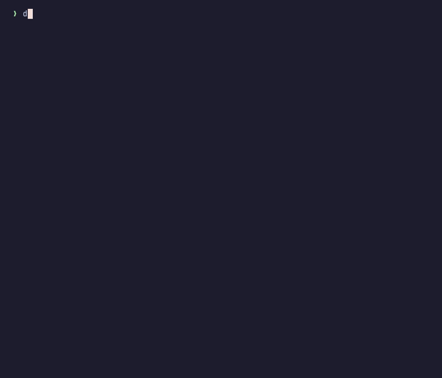
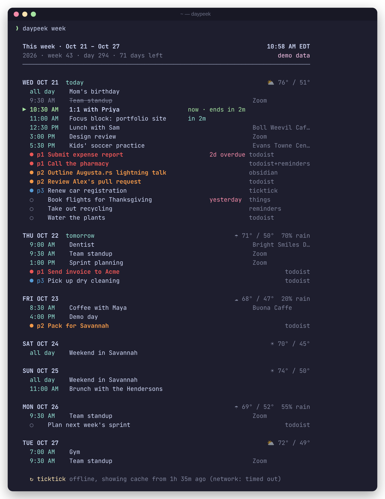
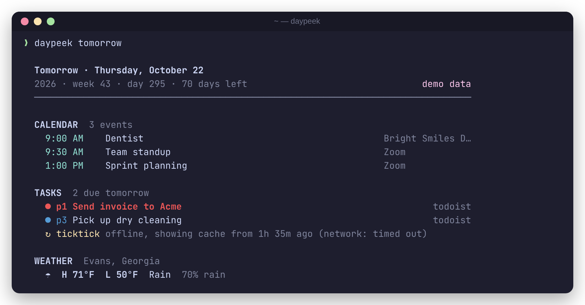
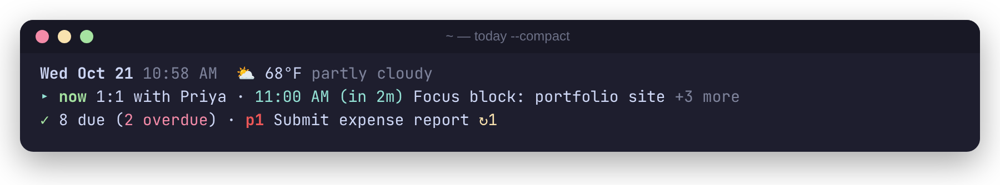
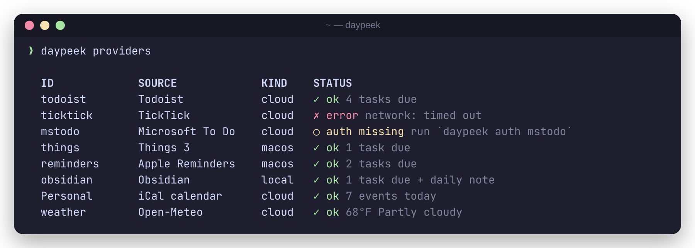
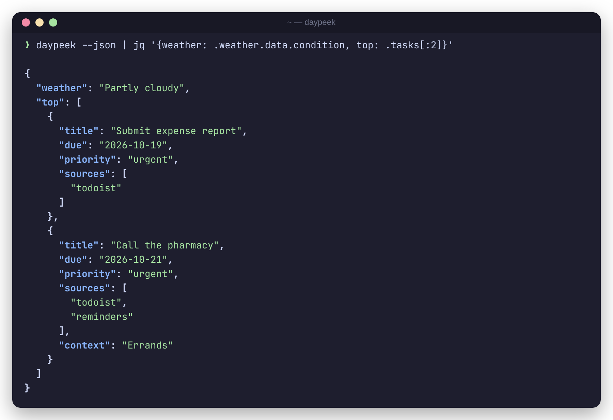
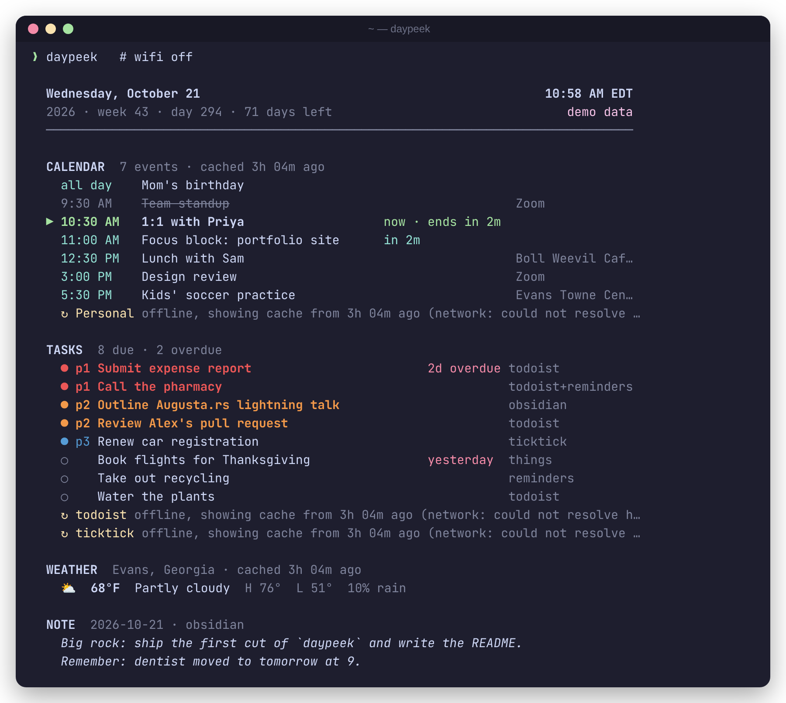
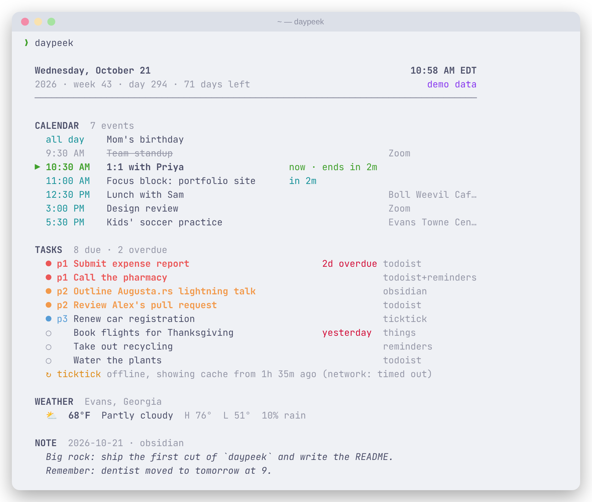
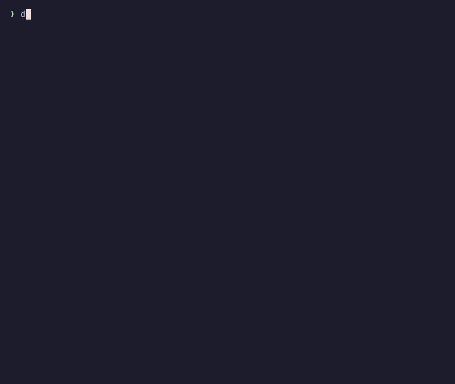
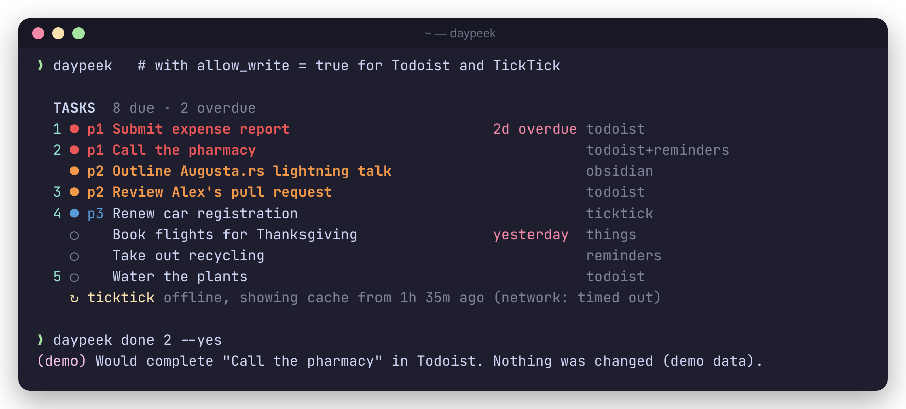

<div align="center">

# daypeek

**Your whole day at a glance, right in your terminal.**<br>
Calendar, tasks from 13 apps, and weather in one command that prints in milliseconds. Read-only unless you say otherwise.

[](https://github.com/Jherin89/daypeek/actions/workflows/ci.yml)
[](LICENSE)
[](https://www.rust-lang.org)
[](#get-started-in-60-seconds)



</div>

## Get started in 60 seconds

**1. Install** with [Homebrew](https://brew.sh) (macOS and Linux):

```sh
brew install jherin89/tap/daypeek
```

or with the install script (macOS and Linux x86_64; it checks the download's SHA-256 and tells you if your PATH needs a fix):

```sh
curl -fsSL https://raw.githubusercontent.com/Jherin89/daypeek/main/install.sh | sh
```

<sub>No prebuilt binary for your platform? <code>cargo install --git https://github.com/Jherin89/daypeek</code> (needs <a href="https://rustup.rs">Rust</a>). The script tells you if this applies.</sub>

**2. Try it with fake data** (no accounts needed)

```sh
daypeek --demo
```

**3. Connect your apps.** A wizard walks you through it, and tokens go to your Keychain. On a Mac, Things 3 and Obsidian are found automatically and pre-ticked.

```sh
daypeek setup
```

**4. Look ahead** whenever you like:

```sh
daypeek tomorrow    # tomorrow's events, tasks due tomorrow, the forecast
daypeek week        # the next seven days, one block per day
```

**Add to your terminal startup** so you see your day in every new tab (it reuses results from the last 5 minutes, so it's instant):

```sh
echo 'daypeek --compact' >> ~/.zshrc      # bash: ~/.bashrc · fish: see docs/SETUP.md
```

## What you get

- 📅 **Today's calendar** from any iCal link (Google, Outlook…) or a CalDAV account (iCloud, Fastmail, Nextcloud), with recurring and all-day events
- 🗓 **Tomorrow and the week ahead** with `daypeek tomorrow` and `daypeek week`, including the daily forecast
- ✅ **Tasks from 13 apps, merged**, including Linear, Asana and Trello, with duplicates folded together, p1–p4 priorities, and a badge showing where each task came from
- 📺 **`--watch`** keeps it open on a spare screen and redraws in place (`q` quits)
- ☑️ **`daypeek done 3`** ticks off task 3 in Todoist or TickTick, *only* if you turn on `allow_write`; otherwise daypeek never changes anything
- ⛅ **Weather** from Open-Meteo, no API key needed
- ⚡ **Instant and offline-friendly.** Results from the last few minutes are reused (`--refresh` fetches now), and when you're offline the last good data is shown and clearly marked.
- 🍎 **Zero setup on a Mac** for Things 3 and Obsidian: with no config at all, daypeek finds them and shows your tasks.
- 🔒 **Private.** Read-only by default, no telemetry, and tokens only go to each app's own API.

## Screenshots

| | |
| :---: | :---: |
| <br>**`daypeek week`**: the next seven days | <br>**`daypeek tomorrow`**: plan ahead |
| <br>**`daypeek setup`**: guided setup in four steps | <br>**`--compact`**: three lines for your shell startup |
| <br>**`daypeek providers`**: is everything connected? | <br>**`--json`**: for scripts, status bars, and `jq` |
| <br>**Offline**: last good data, clearly marked | <br>**Light themes** look good too |
| <br>**`--watch`**: a live dashboard for a spare screen | <br>**`daypeek done 2`**: opt-in, asks first |

<sub>Every screenshot uses <code>daypeek --demo</code> fake data.</sub>

## Supported apps

`daypeek setup` handles all of these. Click an app for the manual setup.

<details>
<summary><b>Todoist</b>: paste your API token</summary>

Todoist → **Settings → Integrations → Developer → Copy API token**, then:

```sh
security add-generic-password -s daypeek-todoist -a "$USER" -w   # macOS Keychain (prompts)
export DAYPEEK_TODOIST_TOKEN='…'                                  # or an env var (Linux)
```

```toml
[providers.todoist]
filter = "today | overdue"
```

[Full Todoist guide →](docs/SETUP.md#todoist)

</details>

<details>
<summary><b>TickTick</b>: your own free developer app, then sign in once</summary>

Register an app at [developer.ticktick.com/manage](https://developer.ticktick.com/manage) with the redirect URL `http://127.0.0.1:8765/callback`, then:

```toml
[providers.ticktick]
client_id = "your-client-id"
```

```sh
TICKTICK_CLIENT_SECRET='…' daypeek auth ticktick   # prints the token to store
```

[Full TickTick guide →](docs/SETUP.md#ticktick)

</details>

<details>
<summary><b>Microsoft To Do</b>: your own Entra app (no secret), then sign in once</summary>

Register an app at [entra.microsoft.com](https://entra.microsoft.com): platform *Mobile and desktop*, redirect `http://localhost/callback`, and Graph permission `Tasks.Read`. Then:

```toml
[providers.mstodo]
client_id = "00000000-0000-0000-0000-000000000000"
```

```sh
daypeek auth mstodo     # prints a refresh token for $MSTODO_REFRESH_TOKEN / Keychain
```

[Full Microsoft To Do guide →](docs/SETUP.md#microsoft-to-do)

</details>

<details>
<summary><b>Google Tasks</b>: your own Google Cloud OAuth client, then sign in once</summary>

Enable the Tasks API and create a **Desktop app** OAuth client in [Google Cloud](https://console.cloud.google.com). Then:

```toml
[providers.gtasks]
client_id = "….apps.googleusercontent.com"
```

```sh
export GTASKS_CLIENT_SECRET='…'
daypeek auth gtasks     # prints a refresh token for $GTASKS_REFRESH_TOKEN / Keychain
```

[Full Google Tasks guide →](docs/SETUP.md#google-tasks), including the 7-day token limit for apps in *Testing* status

</details>

<details>
<summary><b>Notion</b>: an internal connection token and a database</summary>

Create an internal connection in Notion's developer portal, add it to your database (**••• → Connections**), then:

```sh
export NOTION_TOKEN='…'     # or Keychain: daypeek-notion
```

```toml
[providers.notion]
database_id = "the 32 characters in the database URL"
title_property = "Name"
date_property  = "Due"
done_property  = "Done"
```

[Full Notion guide →](docs/SETUP.md#notion)

</details>

<details>
<summary><b>Linear</b>: a personal API key</summary>

Linear → **Settings → Security & access → Personal API keys → New API key** (read access is enough), then:

```sh
export LINEAR_API_KEY='lin_api_…'     # or Keychain: daypeek-linear
```

```toml
[providers.linear]
# teams = ["ENG"]     # optional
```

Shows open issues assigned to you that are due, plus ones in progress. [Full Linear guide →](docs/SETUP.md#linear)

</details>

<details>
<summary><b>Asana</b>: a personal access token</summary>

Asana's [developer console](https://app.asana.com/0/my-apps) → **Create new token**, then:

```sh
export ASANA_TOKEN='…'     # or Keychain: daypeek-asana
```

```toml
[providers.asana]
# workspace = "My Company"     # optional; default = every workspace
```

[Full Asana guide →](docs/SETUP.md#asana)

</details>

<details>
<summary><b>Trello</b>: an API key and a token</summary>

Create a Power-Up at [trello.com/power-ups/admin](https://trello.com/power-ups/admin) → **API key** → click **Token** → **Allow**, then:

```sh
export TRELLO_API_KEY='…'  TRELLO_TOKEN='…'   # or Keychain: daypeek-trello-api-key, daypeek-trello
```

```toml
[providers.trello]
# boards = ["Side projects"]   # optional; default = cards assigned to you
```

[Full Trello guide →](docs/SETUP.md#trello)

</details>

<details>
<summary><b>Things 3</b> (macOS): nothing to set up</summary>

```toml
[providers.things]
```

daypeek reads Things' local database read-only. [Details →](docs/SETUP.md#things-3)

</details>

<details>
<summary><b>Apple Reminders</b> (macOS): allow access once</summary>

```toml
[providers.reminders]
```

The first run asks to let your terminal control Reminders. Click **Allow**. [Details →](docs/SETUP.md#apple-reminders)

</details>

<details>
<summary><b>Obsidian</b>, <b>todo.txt</b>, <b>Markdown</b>: just a path</summary>

```toml
[providers.obsidian]
vault = "~/Documents/Obsidian/Main"
daily_notes_folder = "Daily"        # shows today's note too

[providers.todotxt]
path = "~/todo.txt"

[providers.markdown]
paths = ["~/notes/tasks.md"]
```

Understands Obsidian Tasks `📅 2026-10-21`, Dataview `[due:: …]`, and todo.txt `due:`. [Details →](docs/SETUP.md#obsidian)

</details>

<details>
<summary><b>Calendars</b> (Google, Outlook, any .ics, or CalDAV: iCloud, Fastmail, Nextcloud) and <b>weather</b></summary>

```toml
[[calendars]]
name = "Personal"
url  = "https://calendar.google.com/calendar/ical/…/basic.ics"   # "Secret address in iCal format"

[[calendars]]
name     = "iCloud"
type     = "caldav"
url      = "https://caldav.icloud.com/"
username = "you@icloud.com"        # app-specific password: $DAYPEEK_ICLOUD_PASSWORD or Keychain daypeek-icloud

[weather]
city  = "Evans, Georgia"
units = "imperial"
```

Where to find each calendar's link: [Calendars guide →](docs/SETUP.md#calendars) · CalDAV step by step: [iCloud, Fastmail, Nextcloud →](docs/SETUP.md#caldav-icloud-fastmail-nextcloud)

</details>

| App | Status | | App | Status |
| --- | --- | --- | --- | --- |
| Todoist | ✅ read · ☑️ `done` | | Trello | ✅ read |
| TickTick | ✅ read · ☑️ `done` | | Things 3 (macOS) | ✅ read |
| Microsoft To Do | ✅ read | | Apple Reminders (macOS) | ✅ read |
| Google Tasks | ✅ read | | Obsidian | ✅ read |
| Notion | ✅ read | | todo.txt | ✅ read |
| Linear | ✅ read | | Markdown | ✅ read |
| Asana | ✅ read | | ClickUp, Logseq, Bear | 🗺 planned |
| Calendars: iCal links, CalDAV (iCloud, Fastmail, Nextcloud) | ✅ read | | | |

☑️ `daypeek done` works only after you set `allow_write = true` ([how](docs/USAGE.md#completing-tasks)).

Missing one? [Request it](https://github.com/Jherin89/daypeek/issues/new?template=new_provider.yml), or [add it](CONTRIBUTING.md): each provider is a single file.

## Learn more

| | |
| --- | --- |
| 📦 [**Setup guide**](docs/SETUP.md) | Every install option, the wizard, every app step by step, shell startup for zsh, bash, and fish |
| 📖 [**Usage reference**](docs/USAGE.md) | All flags and subcommands, JSON and `jq` recipes, troubleshooting and FAQ |
| 🔒 [**Privacy**](docs/USAGE.md#privacy) | Read-only; tokens only go to each app's API; the cache lives in `~/.cache/daypeek/` |
| 🧩 [**Contributing**](CONTRIBUTING.md) | How to add a provider in one file |
| 📝 [**Changelog**](CHANGELOG.md) | What's new |

<details>
<summary><b>How it works</b></summary>

```
config.toml ─┬─ calendars ─► fetch .ics ─► parse VEVENTs ─► expand RRULE per day ───┐
             ├─ providers ─► Provider::fetch() (one thread each) ─► merge + dedup ───┼─► full / compact / JSON
             └─ weather ───► geocode (cached) ─► Open-Meteo 7-day forecast ──────────┘
     every source goes through the cache: cached (< 5 min) ▸ live ▸ stale ▸ failed
```

Every source is fetched in parallel with plain threads and a hard timeout. There's no async runtime. A run takes about 0.1–0.5 s when it fetches, and about 5 ms when it reuses results from the last `cache_minutes` (default 5), runs `--offline`, or runs `--demo`. Cloud providers are tested against recorded fixtures, and CI runs on Ubuntu and on macOS (Apple Silicon).

```sh
cargo test && cargo run -- --demo
python3 scripts/screenshot.py && vhs docs/demo.tape && vhs docs/setup.tape   # re-render the images
```

</details>

## License

[MIT](LICENSE) © Jordan Herin
