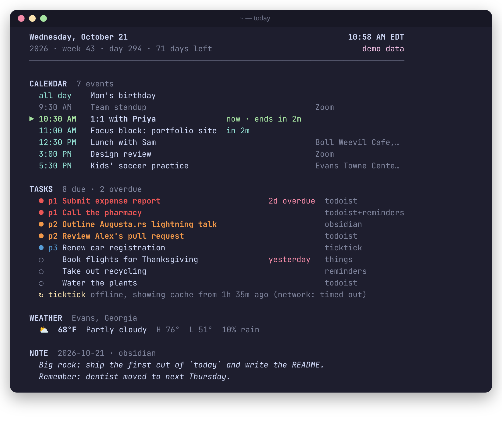

# today

**Your day on one screen.** Calendar, tasks from every app you use, and the
weather, printed in your terminal in milliseconds. Fast enough to run every
time you open a shell.

I juggle a calendar, a couple of task apps, and an Obsidian vault, and I
wanted one glance in the morning (and in every new terminal tab) instead of
six tabs. `today` is a small Rust CLI for that. It pulls everything in
parallel, merges your tasks into one de-duplicated list, and still shows the
last good data when you're offline.

```bash
today
```



<sub>Screenshot made from built-in fake data: `today --demo`. No accounts involved.</sub>

## Features

- **Date header**: weekday, ISO week, day of year, local time and zone.
- **Calendar** from any iCal (`.ics`) feed, such as Google Calendar's secret
  address, iCloud, Outlook, Fastmail, or a local file. Handles all-day and
  multi-day events, time zones (IANA, vendor-prefixed, and Windows names),
  recurring events (`RRULE` with `BYDAY`/`BYMONTHDAY`/`BYSETPOS`/`COUNT`/`UNTIL`),
  `EXDATE`s, moved instances (`RECURRENCE-ID`), and cancellations.
- **Tasks from 10 apps**, merged into one list, de-duplicated by title and due
  date, colored by a normalized priority, each with a source badge.
- **Weather** from [Open-Meteo](https://open-meteo.com) (free, no API key). Give a
  city name or lat/lon.
- **Daily note excerpt** from Obsidian.
- **Offline-first**: every source caches its last good result in
  `~/.cache/today/`, so a dead network shows stale data with a marker and never
  an error screen.
- **Three outputs**: the full dashboard, `--compact` (3 lines, for shell
  startup), and `--json` (for scripts, widgets, and status bars).
- **No secrets in config if you don't want them**: tokens come from env vars or
  the macOS Keychain.

## Install

**From git** (any platform with a Rust toolchain):

```bash
cargo install --git https://github.com/Jherin89/today
```

**From a local checkout:**

```bash
git clone https://github.com/Jherin89/today && cd today
cargo install --path .
```

**Prebuilt binaries** for macOS Apple Silicon (`aarch64-apple-darwin`) and Linux
x86_64 are attached to each [GitHub Release](https://github.com/Jherin89/today/releases):

```bash
tar -xzf today-aarch64-apple-darwin.tar.gz
install -m 755 today-aarch64-apple-darwin/today /usr/local/bin/today
```

Building from source needs Rust 1.85 or newer.

## Quick start

```bash
today --demo          # see it with fake data first
today --init          # write ~/.config/today/config.toml
export TODOIST_API_TOKEN=…   # or any other provider, see below
today providers       # check every source
today
```

### Run it when a shell opens

```bash
# ~/.zshrc
today --compact
```

```
Wed Oct 21 10:58 AM  ⛅ 68°F partly cloudy
▸ now 1:1 with Priya · 11:00 AM (in 2m) Focus block: portfolio site +3 more
✓ 8 due (2 overdue) · p1 Submit expense report ↻1
```

Every request has a hard timeout (`timeout_secs`, default 4 s) and all sources
are fetched at the same time. For a prompt that never waits on the network,
read the cache and refresh it in the background:

```bash
today --compact --offline; (today --json >/dev/null 2>&1 &)
```

`--offline` still reads local sources (Obsidian, Markdown, todo.txt, Things,
Reminders, local `.ics` files). It only skips the network.

## Usage

```
today                  full dashboard
today --compact        2–3 line summary
today --json           everything as JSON (all tasks, not just the first 15)
today --demo           fake data, no config or network needed
today --offline        cached network data only
today --init [--force] write a sample config
today providers        list sources and whether each one works
today auth <provider>  one-time OAuth helper (ticktick, mstodo, gtasks)
  --config <PATH>      use another config file (or set $TODAY_CONFIG)
  --color auto|always|never
```

Colors follow `--color`, `NO_COLOR`, and whether stdout is a terminal.

### Full dashboard (text)

```
  Wednesday, October 21                                               10:58 AM EDT
  2026 · week 43 · day 294 · 71 days left                                demo data
  ────────────────────────────────────────────────────────────────────────────────

  CALENDAR  7 events
    all day    Mom's birthday
    9:30 AM    Team standup                                    Zoom
  ▶ 10:30 AM   1:1 with Priya               now · ends in 2m
    11:00 AM   Focus block: portfolio site  in 2m
    12:30 PM   Lunch with Sam                                  Boll Weevil Cafe,…
    3:00 PM    Design review                                   Zoom
    5:30 PM    Kids' soccer practice                           Evans Towne Cente…

  TASKS  8 due · 2 overdue
    ● p1 Submit expense report                       2d overdue  todoist
    ● p1 Call the pharmacy                                       todoist+reminders
    ● p2 Outline Augusta.rs lightning talk                       obsidian
    ● p2 Review Alex's pull request                              todoist
    ● p3 Renew car registration                                  ticktick
    ○    Book flights for Thanksgiving               yesterday   things
    ○    Take out recycling                                      reminders
    ○    Water the plants                                        todoist
    ↻ ticktick offline, showing cache from 1h 35m ago (network: timed out)

  WEATHER  Evans, Georgia
    ⛅  68°F  Partly cloudy  H 76°  L 51°  10% rain

  NOTE  2026-10-21 · obsidian
    Big rock: ship the first cut of `today` and write the README.
    Remember: dentist moved to next Thursday.
```

Past events are dimmed and struck through. The current event is marked `▶`,
and the next one shows a countdown. "Call the pharmacy" came from both Todoist
and Reminders, so it appears once with both badges.

### `today providers`

Example output:

```
  ID             SOURCE             KIND    STATUS
  todoist        Todoist            cloud   ✓ ok 5 tasks due
  vault          Obsidian           local   ✓ ok 4 tasks due + daily note
  things         Things 3           macos   ✓ ok 2 tasks due
  ticktick       TickTick           cloud   ○ auth missing set $TICKTICK_ACCESS_TOKEN (or run `today auth ticktick`)
  Personal       iCal calendar      cloud   ✓ ok 6 events today
  weather        Open-Meteo         cloud   ✓ ok 68°F Partly cloudy
```

## Supported apps

| App | Status | How it connects | Priority mapping |
| --- | --- | --- | --- |
| **Todoist** | ✅ v1 | API v1 `tasks/filter` (your filter, default `today \| overdue`) | p1–p4 → p1–p4 |
| **TickTick** | ✅ v1 | Official Open API, bring-your-own app | high/med/low → p1/p2/p3 |
| **Microsoft To Do** | ✅ v1 | Microsoft Graph, bring-your-own Azure app | high → p1, low → p4 |
| **Google Tasks** | ✅ v1 | Tasks API v1, bring-your-own OAuth client | (none in Google Tasks) |
| **Things 3** | ✅ v1 (macOS) | Reads Things' local SQLite DB **read-only** | (none in Things) |
| **Apple Reminders** | ✅ v1 (macOS) | Bundled JXA script run by `osascript` | high/med/low → p1/p2/p3 |
| **Notion** | ✅ v1 | Database query; you name the title/date/done properties | select: Urgent/High/Medium/Low, P1–P4 |
| **Obsidian** | ✅ v1 | Vault scan (Tasks plugin + Dataview syntax) + daily note | `🔺 ⏫ 🔼 🔽 ⏬` |
| **todo.txt** | ✅ v1 | Local file, `due:` extension | `(A)`–`(C)` → p1–p3 |
| **Markdown** | ✅ v1 | Any `.md` files or folders with `- [ ]` | `!!!`/`!!`/`!` prefixes |
| Asana | 🗺 planned | | |
| Trello | 🗺 planned | | |
| Linear | 🗺 planned | | |
| ClickUp | 🗺 planned | | |
| Logseq | 🗺 planned | | |
| Bear | 🗺 planned | | |

Priorities are normalized to four levels: **p1** red, **p2** orange, **p3**
blue, **p4** grey, plus "none". The list is sorted by priority, then oldest
due date.

`today` is an independent project. It is not created by, affiliated with, or
supported by any of the apps above.

## Configuration

`~/.config/today/config.toml` (also on macOS, so it lives with your dotfiles).
`$XDG_CONFIG_HOME` and `$TODAY_CONFIG` are honored. `today --init` writes a
commented sample. Every section is optional.

```toml
[general]
timezone = "America/New_York"   # default: system zone
time_format = "12h"             # or "24h"
timeout_secs = 4                # per network request
max_tasks = 15                  # full view; --json always has all
# cache_dir = "~/.cache/today"

[[calendars]]
name = "Personal"
url  = "https://calendar.google.com/calendar/ical/…/basic.ics"   # https, webcal, file://, or a path

[[calendars]]
name = "Work"
url  = "webcal://outlook.office365.com/owa/calendar/…/calendar.ics"

[weather]                        # omit the section to turn weather off
city  = "Evans, Georgia"         # geocoded via Open-Meteo ("Evans, GA" works too)
units = "imperial"               # or "metric"
# latitude = 33.5337             # lat/lon skip geocoding
# longitude = -82.1307

[providers.todoist]
filter = "today | overdue"

[providers.obsidian]
vault = "~/Documents/Obsidian/Main"
daily_notes_folder = "Daily"
daily_note_format = "%Y-%m-%d"
```

### Provider reference

Every `[providers.<id>]` table accepts `enabled = false` and `type = "<kind>"`.
`type` lets you run the same provider more than once, e.g.
`[providers.work-notes] type = "markdown"`. The table key is the badge shown
next to each task.

| Provider | Keys (defaults) |
| --- | --- |
| `todoist` | `filter` (`"today \| overdue"`), `token_env` (`TODOIST_API_TOKEN`) |
| `ticktick` | `projects` (`[]` = inbox + all), `client_id` (for `today auth`), `token_env` (`TICKTICK_ACCESS_TOKEN`), `base_url` (`https://api.ticktick.com`; use `https://api.dida365.com` for Dida365) |
| `mstodo` | `client_id`, `tenant` (`"common"`; `"consumers"` for personal accounts), `lists` (`[]` = all), `access_token_env` / `refresh_token_env` |
| `gtasks` | `client_id`, `lists` (`[]` = all), `access_token_env` / `refresh_token_env` / `client_secret_env` |
| `things` | `db_path` (auto-detected in `~/Library/Group Containers/…`) |
| `reminders` | `lists` (`[]` = all), `timeout_secs` (`10`) |
| `notion` | `database_id` (required), `title_property` (`"Name"`), `date_property` (`"Due"`), `done_property` (`"Done"`, a checkbox), `done_values` (set e.g. `["Done"]` if `done_property` is a status/select), `priority_property` |
| `obsidian` | `vault` (required), `daily_notes_folder` (`""`), `daily_note_format` (`"%Y-%m-%d"`), `excerpt_lines` (`4`), `include_undated` (`false`), `ignore` (`["templates", "Templates"]`) |
| `todotxt` | `path` (`"~/todo.txt"`), `include_undated` (`false`) |
| `markdown` | `paths` (`["~/.config/today/tasks.md"]`, files or folders), `include_undated` (`true`) |

**Task syntax in Markdown and Obsidian:** `- [ ] Title 📅 2026-10-21`
(Tasks plugin due), `⏳ 2026-10-21` (scheduled; used when there's no due date),
`[due:: 2026-10-21]` (Dataview), `due:2026-10-21`, and `@due(2026-10-21)`.
`- [/]` (in progress) counts as open. `- [x]` and `- [-]` don't. Undated
tasks in *today's daily note* count as due today.

## Credentials

`today` never ships, logs, or caches a secret. For each secret it looks in
this order:

1. **Environment variable**, e.g. `TODOIST_API_TOKEN`.
2. **macOS Keychain**, as a generic password whose service is
   `today-<provider id>` (secondary values add a suffix, e.g.
   `today-gtasks-refresh-token`):
   ```bash
   security add-generic-password -s today-todoist -a "$USER" -w   # prompts for the token
   ```
3. **Config file** (`token = "…"`, Todoist/TickTick/Notion only). This works,
   but it's the least safe option. Keep the file out of git.

| Provider | What you need |
| --- | --- |
| Todoist | API token: Settings → Integrations → Developer → `TODOIST_API_TOKEN` |
| Notion | [Internal integration](https://www.notion.so/my-integrations) secret → `NOTION_TOKEN`. Share the database with the integration. |
| TickTick | Register an app at [developer.ticktick.com](https://developer.ticktick.com/manage) with redirect `http://127.0.0.1:8765/callback`. Then `TICKTICK_CLIENT_SECRET=… today auth ticktick` prints an access token (valid ~6 months) for `TICKTICK_ACCESS_TOKEN`. |
| Microsoft To Do | Register an app in [Azure → App registrations](https://portal.azure.com/#view/Microsoft_AAD_RegisteredApps/ApplicationsListBlade): *Mobile and desktop* platform, redirect `http://127.0.0.1:8765/callback`, delegated `Tasks.Read`. Put `client_id` in config, run `today auth mstodo`, and store the refresh token as `MSTODO_REFRESH_TOKEN`. No client secret is involved (PKCE public client). |
| Google Tasks | Create a *Desktop app* OAuth client in Google Cloud with the Tasks API enabled. Put `client_id` in config and the client secret in `GTASKS_CLIENT_SECRET`, then `today auth gtasks` prints a refresh token for `GTASKS_REFRESH_TOKEN`. |
| Things 3, Reminders, Obsidian, todo.txt, Markdown | Nothing. Reminders asks once for macOS Automation permission. |

`today auth` runs a standard loopback OAuth flow (state check, PKCE where the
service supports it). It opens your browser, catches the redirect on
`127.0.0.1`, and prints the token **to your terminal only**. It doesn't write
the token anywhere. The project contains no client IDs or secrets of its own.

## How it works

```
config.toml ─┬─ calendars ─► fetch .ics ─► parse VEVENTs ─► expand RRULE for today ─┐
             ├─ providers ─► Provider::fetch() (one thread each) ─► merge + dedup ───┼─► Snapshot ─► full / compact / JSON
             └─ weather ───► geocode (cached) ─► Open-Meteo forecast ────────────────┘
                       every source goes through the cache: live ▸ stale ▸ failed
```

- **Concurrency.** Each calendar, provider, and the weather run on their own
  thread under `std::thread::scope`, with blocking `ureq` requests and a hard
  per-request timeout. No async runtime, which keeps startup at a few
  milliseconds.
- **Providers** implement one small trait (`id`, `name`, `kind`, `check`,
  `fetch`, `health`) and live one per file in
  [`src/providers/`](src/providers). See [CONTRIBUTING.md](CONTRIBUTING.md).
- **iCal** is parsed by a small forgiving reader (`src/calendar/ics.rs`), and
  recurrence is evaluated per day (`src/calendar/rrule.rs`) instead of
  expanding whole series.
- **Cache.** One JSON file per source (`0600` on Unix). Calendars cache the raw
  feed, so tomorrow's offline view is still correct.

On a Linux x86_64 check, with two calendars, five providers, and weather
configured: about **0.1–0.5 s** when fetching live, **5 ms** with `--offline`,
and **3 ms** with `--demo`.

## Development

```bash
cargo test                          # unit + fixture + CLI tests
cargo run -- --demo
python3 scripts/screenshot.py       # regenerate docs/screenshot.png from --demo
vhs docs/demo.tape                  # optional animated GIF (macOS: brew install vhs)
```

Every network provider is tested against recorded JSON fixtures in
[`tests/fixtures/`](tests/fixtures). Things is tested against a generated
SQLite DB with the real schema subset, and Reminders against sample bridge
output. CI runs `fmt`, `clippy -D warnings`, and `test` on Ubuntu and on
macOS Apple Silicon. Pushing a `v*` tag builds release binaries for
`aarch64-apple-darwin` and `x86_64-unknown-linux-gnu`.

## Roadmap

- [ ] Asana, Trello, Linear, ClickUp providers
- [ ] Logseq journals and Bear notes
- [ ] CalDAV (iCloud/Fastmail) without a public `.ics` link
- [ ] Mark tasks done from the terminal (`today done 3`)
- [ ] `today week`: the next 7 days
- [ ] Homebrew tap
- [ ] Optional live TUI mode that refreshes on a timer

## License

MIT © Jordan Herin
