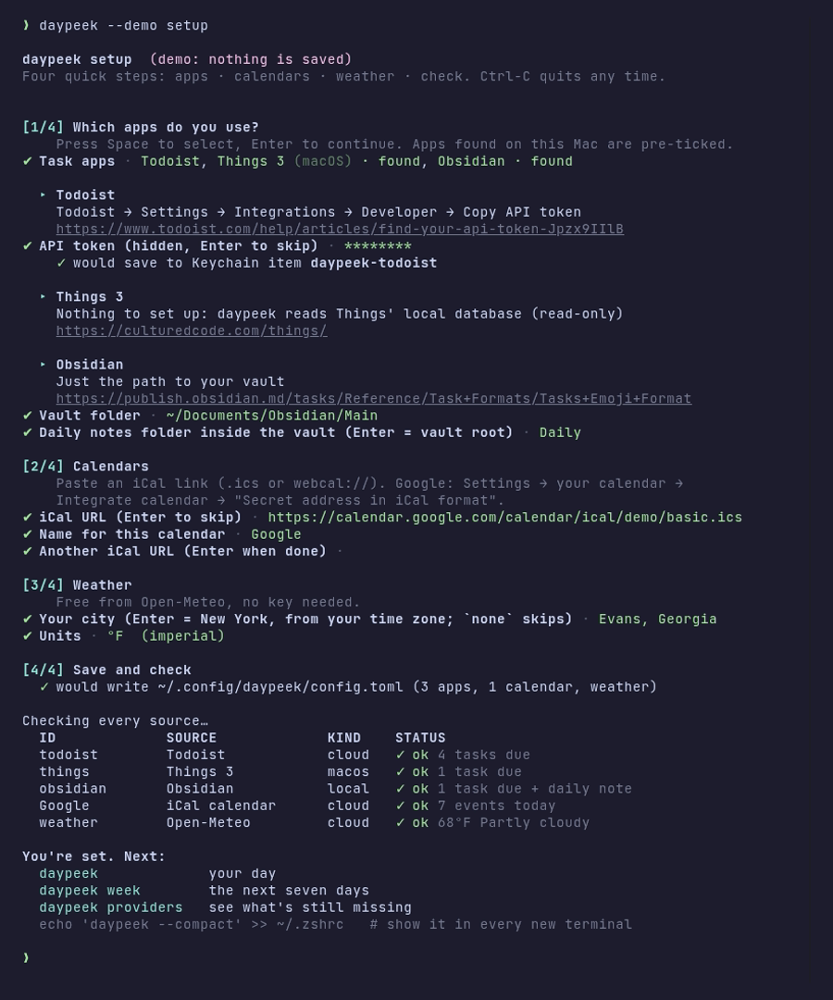

# Setup guide

This takes you from nothing to `daypeek` running every time you open a
terminal. **Most people only need three commands:**

```sh
brew install jherin89/tap/daypeek     # or: curl -fsSL https://raw.githubusercontent.com/Jherin89/daypeek/main/install.sh | sh
daypeek --demo
daypeek setup
```

On a Mac that has Things 3 or Obsidian, plain `daypeek` already shows those
tasks before you set anything up ([details](#no-config-yet-on-a-mac)).

The rest of this page covers the details and the manual alternative. You only
need the sections for apps you actually use.

- [1. Install](#1-install)
- [2. Try the demo](#2-try-the-demo)
- [3. Run the setup wizard](#3-run-the-setup-wizard) (recommended), or [write the config by hand](#or-write-the-config-by-hand)
- [4. Connect your apps manually](#4-connect-your-apps) (what the wizard does, step by step)
  - [Credentials: env vars or the macOS Keychain](#credentials)
  - Cloud: [Todoist](#todoist) · [TickTick](#ticktick) · [Microsoft To Do](#microsoft-to-do) · [Google Tasks](#google-tasks) · [Notion](#notion) · [Linear](#linear) · [Asana](#asana) · [Trello](#trello)
  - macOS: [Things 3](#things-3) · [Apple Reminders](#apple-reminders)
  - Local files: [Obsidian](#obsidian) · [todo.txt](#todotxt) · [Markdown](#markdown)
  - [Calendars](#calendars): Google · iCloud · Outlook · any `.ics`
  - [CalDAV accounts](#caldav-icloud-fastmail-nextcloud): iCloud · Fastmail · Nextcloud · others
  - [Weather](#weather)
- [5. Run it when a terminal opens](#5-run-it-when-a-terminal-opens)
- [Next: usage reference and troubleshooting](USAGE.md)

---

## 1. Install

### Option A: Homebrew (macOS and Linux)

If you use [Homebrew](https://brew.sh):

```sh
brew install jherin89/tap/daypeek
```

That adds the [jherin89/tap](https://github.com/Jherin89/homebrew-tap) tap and
installs daypeek; `brew upgrade daypeek` updates it later. Apple Silicon Macs,
Intel Macs and x86_64 Linux get the prebuilt release binary (nothing to compile).
ARM Linux builds the same release from source (Homebrew installs Rust for the
build and it takes a few minutes).

### Option B: one-line installer (macOS and Linux x86_64)

```sh
curl -fsSL https://raw.githubusercontent.com/Jherin89/daypeek/main/install.sh | sh
```

The [script](../install.sh) downloads the latest release for your platform and
checks its SHA-256. It installs into the first of `~/.local/bin`, `~/bin` or
`/usr/local/bin` that's already on your `PATH`. If none is (common on a new
Mac), it uses `~/.local/bin` and prints the exact one line to paste to fix your
`PATH`, plus next steps that work before you do.

Choose the folder with `DAYPEEK_INSTALL_DIR`, or with options after `sh -s --`:

```sh
curl -fsSL https://raw.githubusercontent.com/Jherin89/daypeek/main/install.sh | DAYPEEK_INSTALL_DIR=~/bin sh
curl -fsSL https://raw.githubusercontent.com/Jherin89/daypeek/main/install.sh | sh -s -- --dir ~/bin --version v0.2.0
```

If there's no release for your platform yet, it prints the Cargo command from
Option D instead.

### Option C: download the binary yourself

1. Open [Releases](https://github.com/Jherin89/daypeek/releases) and download
   the file for your computer, along with its `.sha256` file:
   - Mac with an M-series chip: `daypeek-aarch64-apple-darwin.tar.gz`
   - Intel Mac: `daypeek-x86_64-apple-darwin.tar.gz`
   - Linux x86_64: `daypeek-x86_64-unknown-linux-musl.tar.gz`, a static build that
     runs on any distribution
2. Verify and unpack it:

   ```sh
   shasum -a 256 -c daypeek-aarch64-apple-darwin.sha256   # Linux: sha256sum -c …
   tar xzf daypeek-aarch64-apple-darwin.tar.gz
   ```

3. Put it on your `PATH`:

   ```sh
   mkdir -p ~/.local/bin && mv daypeek-aarch64-apple-darwin/daypeek ~/.local/bin/
   # make sure ~/.local/bin is on PATH, e.g. in ~/.zshrc:
   # export PATH="$HOME/.local/bin:$PATH"
   ```

4. **macOS only:** the binary isn't notarized, so if Gatekeeper blocks it with
   *"cannot be opened because the developer cannot be verified"*, remove the
   download quarantine flag once:

   ```sh
   xattr -d com.apple.quarantine ~/.local/bin/daypeek
   ```

### Option D: build with Cargo

You need Rust 1.85 or newer. If you don't have Rust yet, install it with
[rustup](https://rustup.rs):

```sh
curl --proto '=https' --tlsv1.2 -sSf https://sh.rustup.rs | sh
# then open a new terminal, or: source "$HOME/.cargo/env"
rustc --version     # 1.85.0 or newer
```

Then pick one:

```sh
# straight from GitHub
cargo install --git https://github.com/Jherin89/daypeek

# or from a clone
git clone https://github.com/Jherin89/daypeek
cd daypeek
cargo install --path .

# or from crates.io, once it's published there
cargo install daypeek
```

Cargo puts the binary in `~/.cargo/bin`, which rustup adds to your `PATH`.

✅ **Check:** `daypeek --version` prints `daypeek 0.2.0`.

## 2. Try the demo

```sh
daypeek --demo              # full dashboard with fake data
daypeek --demo --compact    # the 3-line version
daypeek --demo tomorrow     # tomorrow
daypeek --demo week         # the next seven days
daypeek --demo --json       # machine-readable
daypeek --demo providers    # what the health check looks like
```

None of these read your config or touch the network.

## 3. Run the setup wizard

```sh
daypeek setup
```



<sub>Animated version: [setup.gif](setup.gif) (demo mode, fake input).</sub>

It takes about a minute:

1. **Pick your apps** from a checklist: press **Space** to tick an app, **Enter**
   to continue. Apps found on this Mac (Things 3, your Obsidian vault) are
   already ticked. If you press Enter with nothing ticked, it asks once more;
   press Enter again to skip task apps.
2. **For each app**, it shows one line on where to get the credential, plus a
   link to the official docs, then asks for it:
   - Tokens are typed with **hidden input**. On macOS they're saved straight to
     your **Keychain** (`daypeek-<app>`). On Linux the wizard tells you which
     env var to add to your shell profile, so the token never lands in a file.
   - TickTick, Microsoft To Do, and Google Tasks ask for your app's client ID
     and then offer to **sign in in your browser**. The resulting token is stored
     the same way.
   - Obsidian, todo.txt, and Markdown just ask for a path (a detected vault,
     with its daily-notes folder and date format, is the default). Things and
     Reminders need nothing.
3. **Calendars:** paste one or more iCal links ([where to find them](#calendars)).
4. **Weather:** it suggests a city from your time zone (for example *New York*
   for `America/New_York`). Press Enter to keep it, type your own city, or type
   `none` to skip weather.
5. It writes `~/.config/daypeek/config.toml` (readable only by you, with any old
   file kept as `config.toml.bak`) and runs the [health check](#4-connect-your-apps).

`daypeek --demo setup` walks through the same prompts without saving
anything. Run `daypeek setup` again any time to change your setup. If it's not
in a terminal (in a script, say), it exits with a hint instead of hanging.

### No config yet on a Mac?

With no config file at all, `daypeek` looks for apps that keep their data on
your Mac and uses them right away:

- **Things 3**: its local database (opened read-only).
- **Obsidian**: the vault you used most recently, from Obsidian's own vault
  list (`~/Library/Application Support/obsidian/obsidian.json`), including the
  daily-notes folder and date format you set in Obsidian.

You'll see a line like *"Found Things 3 and Obsidian (Main) on this Mac"* under
the dashboard. Nothing is written to disk; run `daypeek setup` to add calendars
and weather and save a config. On Linux nothing is auto-detected, and `daypeek`
points you to `daypeek setup`.

### Or write the config by hand

```sh
daypeek --init
```

This writes a starter file to `~/.config/daypeek/config.toml` (the same place
on macOS and Linux, so it can live with your dotfiles). Everything in it is
commented out, so nothing turns on until you uncomment it, and the file is
readable only by you. If a config already exists, `--init` refuses to
overwrite it unless you add `--force` (the old one is kept as `config.toml.bak`).
The `--config <path>` flag or the `DAYPEEK_CONFIG` env var point `daypeek` at a
different file. `$XDG_CONFIG_HOME` is also honored.

Every section is optional. A complete example:

```toml
[general]
timezone = "America/New_York"   # default: your system time zone
time_format = "12h"             # or "24h"
timeout_secs = 4                # per network request
max_tasks = 15                  # tasks shown in the full view (--json always has all)
cache_minutes = 5               # reuse results this fresh; 0 = always fetch
# cache_dir = "~/.cache/daypeek"

[[calendars]]                   # repeat for each calendar
name = "Personal"
url  = "https://calendar.google.com/calendar/ical/…/basic.ics"

[weather]                       # remove this section to turn weather off
city  = "Evans, Georgia"
units = "imperial"              # or "metric"

[providers.todoist]             # one [providers.<id>] block per app
filter = "today | overdue"

[providers.obsidian]
vault = "~/Documents/Obsidian/Main"
daily_notes_folder = "Daily"
```

Unknown keys are reported as errors, so a typo won't be silently ignored.

**Two of the same app.** The `<id>` in `[providers.<id>]` is normally the app's
name. To use an app twice, give it any id and set `type`:

```toml
[providers.work-notes]
type  = "markdown"
paths = ["~/work/todo.md"]
```

✅ **Check:** `daypeek providers` lists everything you configured. Anything
that still needs a token shows `○ auth missing` with a hint telling you what to set.

## 4. Connect your apps

> `daypeek setup` does all of this for you. Use this section to do it by hand,
> to change one app later, or to see exactly what the wizard stores.

<a id="credentials"></a>
### Credentials: env vars or the macOS Keychain

`daypeek` looks for each secret in this order:

1. **An environment variable.** The name for each app is listed below.
2. **The macOS login Keychain:** a generic password whose *service* is
   `daypeek-<id>` (for example `daypeek-todoist`), or
   `daypeek-<id>-<name>` for secondary values (for example
   `daypeek-gtasks-refresh-token`).
3. **The config file** (`token = "…"`). This works, but it's the least safe
   option. If your config is in a dotfiles repo, don't do it.

Saving to the Keychain (run without a value after `-w` and it prompts, so the
secret stays out of your shell history):

```sh
security add-generic-password -s daypeek-todoist -a "$USER" -w
# to replace an existing one:
security add-generic-password -U -s daypeek-todoist -a "$USER" -w
```

> Never commit a token. The repo's `.gitignore` already ignores `config.toml`,
> `.env`, and `*.token`.

---

### Todoist

1. In the Todoist web app, click your avatar (top left) → **Settings** →
   **Integrations** → **Developer**, and click **Copy API token**.
   ([Todoist help: find your API token](https://www.todoist.com/help/articles/find-your-api-token-Jpzx9IIlB))
2. Store it:

   ```sh
   export DAYPEEK_TODOIST_TOKEN='paste-token-here'            # e.g. in ~/.zshrc
   # or, macOS Keychain:
   security add-generic-password -s daypeek-todoist -a "$USER" -w
   ```

   `TODOIST_API_TOKEN` is also accepted if you already have it set for other tools.
3. Config:

   ```toml
   [providers.todoist]
   filter = "today | overdue"     # any Todoist filter query
   ```

4. ✅ `daypeek providers` → `todoist  ✓ ok N tasks due`.

Priorities map directly: Todoist p1–p4 → daypeek p1–p4.

### TickTick

TickTick's Open API needs an app that you register yourself. `daypeek` ships no
client ID or secret.

1. Sign in at the [TickTick Developer Center → Manage Apps](https://developer.ticktick.com/manage)
   and click **New App**. Give it a name (for example `daypeek`) and click **Add**.
2. Click **Edit** on the new app. Copy the **Client ID** and **Client Secret**,
   set **OAuth redirect URL** to exactly:

   ```
   http://127.0.0.1:8765/callback
   ```

   then click **Save**.
3. Config:

   ```toml
   [providers.ticktick]
   client_id = "your-client-id"
   # projects = ["Work", "Home"]          # default: inbox + every open project
   # base_url = "https://api.dida365.com" # for Dida365 accounts
   ```

4. Get an access token once (it opens your browser and listens on
   `127.0.0.1:8765` for the redirect):

   ```sh
   TICKTICK_CLIENT_SECRET='your-client-secret' daypeek auth ticktick
   ```

   It prints the token and the exact commands to store it, for example:

   ```sh
   export TICKTICK_ACCESS_TOKEN='…'
   # or: security add-generic-password -s daypeek-ticktick -a "$USER" -w
   ```

   The client secret is only needed for this step. TickTick access tokens last
   a long time (about six months). When yours expires, run step 4 again.
5. ✅ `daypeek providers` → `ticktick  ✓ ok`.

References: [TickTick Open API docs](https://developer.ticktick.com/).
Scope requested: `tasks:read`.

### Microsoft To Do

This uses Microsoft Graph with your own app registration. It's a public client
with PKCE, so **there's no client secret**.

1. Sign in to the [Microsoft Entra admin center](https://entra.microsoft.com)
   and go to **Entra ID → App registrations → New registration**.
   ([Microsoft: register an app](https://learn.microsoft.com/en-us/entra/identity-platform/quickstart-register-app))
   - **Name:** `daypeek`
   - **Supported account types:** choose *Any Entra ID Tenant + Personal
     Microsoft accounts* if you use an Outlook.com or Hotmail account, or
     *Single tenant* for work-only use.
   - Click **Register**, then copy the **Application (client) ID**.
2. **Authentication → Add a platform → Mobile and desktop applications**, and
   add the custom redirect URI:

   ```
   http://localhost/callback
   ```

   Microsoft ignores the port on `localhost` redirect URIs, so this matches the
   `--port` you use below. The portal won't accept `http://127.0.0.1` here.
   ([Microsoft: redirect URI rules](https://learn.microsoft.com/en-us/entra/identity-platform/reply-url#localhost-exceptions))
3. **API permissions → Add a permission → Microsoft Graph → Delegated
   permissions**, and add `Tasks.Read` (`offline_access` is requested
   automatically at sign-in).
4. Config:

   ```toml
   [providers.mstodo]
   client_id = "00000000-0000-0000-0000-000000000000"
   # tenant = "common"     # "consumers" = personal accounts only, "organizations", or your tenant id
   # lists  = ["Tasks"]    # default: all lists
   ```

5. Sign in once:

   ```sh
   daypeek auth mstodo
   ```

   Store the printed **refresh token**:

   ```sh
   export MSTODO_REFRESH_TOKEN='…'
   # or: security add-generic-password -s daypeek-mstodo-refresh-token -a "$USER" -w
   ```

   `daypeek` uses it to get a short-lived access token on each run. A
   ready-made access token in `MSTODO_ACCESS_TOKEN` also works.
6. ✅ `daypeek providers` → `mstodo  ✓ ok`.

Priority: To Do importance *high* (starred) → p1, *low* → p4.

### Google Tasks

Google requires a client secret even for desktop apps. It's *your* secret,
from *your* Cloud project, so keep it in an env var or the Keychain.
([Google Tasks API quickstart](https://developers.google.com/workspace/tasks/quickstart/python), steps 1–3)

1. In the [Google Cloud console](https://console.cloud.google.com), create (or
   pick) a project and
   [enable the Google Tasks API](https://console.cloud.google.com/flows/enableapi?apiid=tasks.googleapis.com).
2. **Google Auth platform → Branding → Get started.** Enter an app name and
   your email. Under **Audience**, choose **Internal** if you have a Google
   Workspace account. With a personal Gmail account, choose **External**, then on
   the **Audience** page add your own address under **Test users**.
3. **Google Auth platform → Clients → Create client → Application type: Desktop
   app**, then **Create**. Copy the **Client ID** and **Client secret**.
4. Config and secret:

   ```toml
   [providers.gtasks]
   client_id = "1234567890-abc….apps.googleusercontent.com"
   # lists = ["My Tasks"]   # default: all lists
   ```

   ```sh
   export GTASKS_CLIENT_SECRET='…'
   # or: security add-generic-password -s daypeek-gtasks-client-secret -a "$USER" -w
   ```

5. Sign in once (scope: `tasks.readonly`):

   ```sh
   daypeek auth gtasks
   ```

   Store the printed refresh token:

   ```sh
   export GTASKS_REFRESH_TOKEN='…'
   # or: security add-generic-password -s daypeek-gtasks-refresh-token -a "$USER" -w
   ```

6. ✅ `daypeek providers` → `gtasks  ✓ ok`.

> ⚠️ **7-day expiry.** When an *External* app is in **Testing** status, Google
> expires its refresh tokens after 7 days
> ([Google: refresh token expiration](https://developers.google.com/identity/protocols/oauth2#expiration)).
> Either run `daypeek auth gtasks` again when it stops working, or move the app
> out of Testing on the **Audience** page. An *Internal* Workspace app doesn't
> have this limit.

Google Tasks has no priorities, so these tasks show without one.

### Notion

1. Create an **internal connection** (Notion's new name for an internal
   integration). You need to be a Workspace Owner: open the Notion **Developer
   portal → Build → Internal connections → Create a new connection**, then copy
   the **API token** from the **Configuration** tab. Read access is all
   `daypeek` needs.
   ([Notion: internal connections](https://developers.notion.com/guides/get-started/internal-connections))
2. Give it access to your task database. Either use the **Content access** tab
   in the portal, or open the database in Notion → **•••** →
   **Connections** → **+ Add connection** → pick your connection. Until you do
   this, Notion's API answers *not found*.
3. Copy the **database ID**: the 32-character code in the database's URL
   (`notion.so/<workspace>/`**`a1b2c3…`**`?v=…`), before `?v=`.
4. Store the token and describe your database's columns:

   ```sh
   export NOTION_TOKEN='ntn_…'
   # or: security add-generic-password -s daypeek-notion -a "$USER" -w
   ```

   ```toml
   [providers.notion]
   database_id    = "a1b2c3d4e5f6…"
   title_property = "Name"        # the title column
   date_property  = "Due"         # a date column
   done_property  = "Done"        # a checkbox column…
   # done_values  = ["Done"]      # …or a Status/Select column + the values that mean done
   # priority_property = "Priority"   # optional Select: Urgent/High/Medium/Low or P1–P4
   ```

5. ✅ `daypeek providers` → `notion  ✓ ok`.

### Linear

daypeek shows open issues **assigned to you** that are due (or overdue), plus
issues you've started even if they have no due date.

1. In Linear, open **Settings** (press `G` then `S`, or click your workspace
   name → **Settings**) → under *Account* choose **Security & access**.
2. Under **Personal API keys**, click **New API key**. Give it a name like
   `daypeek`. **Read** access is all daypeek needs; you can also limit it to
   certain teams. Click **Create**.
   ([Linear: API and webhooks](https://linear.app/docs/api-and-webhooks))
3. Copy the key (it starts with `lin_api_`). Linear shows it only once.
4. Store it:

   ```sh
   export LINEAR_API_KEY='lin_api_…'                      # e.g. in ~/.zshrc
   # or, macOS Keychain:
   security add-generic-password -s daypeek-linear -a "$USER" -w
   ```

5. Config:

   ```toml
   [providers.linear]
   # teams = ["ENG", "OPS"]          # team keys (the letters in ENG-123); empty = all
   # include_in_progress = true      # started issues show even with no due date
   # include_undated = false         # true = every open issue assigned to you
   ```

6. ✅ `daypeek providers` → `linear  ✓ ok N tasks due`.

Titles look like `ENG-42 Fix the login bug`, with the team as the context.
Linear's Urgent/High/Medium/Low become p1–p4.

### Asana

daypeek shows your **incomplete tasks assigned to you** that are due today or
earlier (or in the week, for `daypeek week`).

1. Open the Asana developer console at
   [app.asana.com/0/my-apps](https://app.asana.com/0/my-apps). (From Asana:
   your profile photo → **Settings** → **Apps** → **View developer console**.)
2. Click **+ Create new token**, name it `daypeek`, accept the terms, and click
   **Create token**. Copy it right away; Asana shows it only once.
   ([Asana: personal access token](https://developers.asana.com/docs/personal-access-token))
3. Store it:

   ```sh
   export ASANA_TOKEN='…'
   # or: security add-generic-password -s daypeek-asana -a "$USER" -w
   ```

4. Config:

   ```toml
   [providers.asana]
   # workspace = "My Company"   # name or ID; leave out to read every workspace you're in
   # include_undated = false    # true = also tasks with no due date
   ```

5. ✅ `daypeek providers` → `asana  ✓ ok`. If `workspace` doesn't match, the
   error lists the names of your workspaces.

Asana has no standard priority field, so these tasks show without one. The
task's first project is shown as its context.

### Trello

Trello needs two values: an **API key** (which identifies "your app") and a
**token** (which lets that key read your boards).

1. Go to [trello.com/power-ups/admin](https://trello.com/power-ups/admin) and
   click **New**. Fill in a name (`daypeek`), pick your workspace, and enter
   your email; the *Iframe connector URL* can be left empty. Click **Create**.
2. On the Power-Up's page, open **API key** → **Generate a new API key**. Copy
   the **API key**. (You don't need the *secret*; daypeek never uses it.)
3. Next to the key, click the **Token** link. Trello asks to let the app read
   your account: click **Allow**, and copy the token it shows.
   ([Trello: REST API introduction](https://developer.atlassian.com/cloud/trello/guides/rest-api/api-introduction/))
4. Store both:

   ```sh
   export TRELLO_API_KEY='…'
   export TRELLO_TOKEN='…'
   # or, macOS Keychain:
   security add-generic-password -s daypeek-trello-api-key -a "$USER" -w
   security add-generic-password -s daypeek-trello -a "$USER" -w
   ```

5. Config. By default you see open cards **assigned to you** (you're a member
   of the card) that are due:

   ```toml
   [providers.trello]
   # boards = ["Side projects"]   # only these boards (names or IDs)
   # mine_only = true             # false = every due card on `boards`, not just yours
   # include_undated = false      # true = also cards with no due date
   ```

6. ✅ `daypeek providers` → `trello  ✓ ok`.

Cards with a completed due date are skipped. The board's name is the context.
The key and token are sent in a request header, never in a URL, so they don't
show up in error messages.

### Things 3

macOS only. Nothing to set up: `daypeek` opens Things' local database
**read-only** and shows to-dos in your Today list plus anything with a deadline
today or earlier. `daypeek tomorrow` and `daypeek week` also show to-dos
scheduled or due on those days. With no config file at all, Things is found
automatically.

1. Config:

   ```toml
   [providers.things]
   # db_path = "…/main.sqlite"   # only if auto-detection fails
   ```

   It looks in
   `~/Library/Group Containers/JLMPQHK86H.com.culturedcode.ThingsMac/ThingsData-*/Things Database.thingsdatabase/main.sqlite`
   (the location used by current Things 3 releases), then in the older location
   without the `ThingsData-*` folder.
2. If macOS asks whether your terminal may access data from other apps, allow
   it. If `daypeek providers` still reports a permission error, give your
   terminal app **Full Disk Access** in **System Settings → Privacy & Security**.
3. ✅ `daypeek providers` → `things  ✓ ok`.

Things isn't affiliated with this project, and its database format is
undocumented. See [USAGE.md → Things](USAGE.md#things-shows-an-error) if a
Things update breaks it.

### Apple Reminders

macOS only. `daypeek` runs a small bundled JavaScript for Automation (JXA)
script through `osascript`. It's read-only.

1. Config:

   ```toml
   [providers.reminders]
   # lists = ["Reminders", "Groceries"]   # default: all lists
   # timeout_secs = 10                    # large libraries can be slow
   ```

2. Run `daypeek providers` once **in the terminal app you'll normally use**.
   macOS asks *"Terminal wants access to control Reminders"*. Click **Allow**.
   If you clicked *Don't Allow*, turn it back on in **System Settings → Privacy &
   Security → Automation → (your terminal) → Reminders**.
3. ✅ `daypeek providers` → `reminders  ✓ ok`.

Priority: high/medium/low → p1/p2/p3.

### Obsidian

`daypeek` scans your vault for open `- [ ]` tasks with a due date and shows the
first lines of today's daily note. On a Mac, `daypeek setup` (and a first run
with no config) finds your most recent vault for you.

```toml
[providers.obsidian]
vault = "~/Documents/Obsidian/Main"
daily_notes_folder = "Daily"      # "" = vault root
daily_note_format  = "%Y-%m-%d"   # strftime; matches Obsidian's default YYYY-MM-DD
# excerpt_lines   = 4             # 0 = no note excerpt
# include_undated = false         # also show undated tasks from the whole vault (noisy)
# ignore          = ["templates", "Templates"]   # dot-folders are always skipped
```

Recognized task syntax:

| Syntax | From |
| --- | --- |
| `📅 2026-10-21` (due), `⏳ 2026-10-21` (scheduled) | [Tasks plugin](https://publish.obsidian.md/tasks/Reference/Task+Formats/Tasks+Emoji+Format) |
| `🔺` `⏫` `🔼` `🔽` `⏬` | [Tasks plugin priorities](https://publish.obsidian.md/tasks/Getting+Started/Priority) → p1, p1, p2, p3, p4 |
| `[due:: 2026-10-21]` | Dataview inline field |
| `due:2026-10-21`, `@due(2026-10-21)` | todo.txt / TaskPaper style |

Undated tasks *inside today's daily note* count as due today.

✅ `daypeek providers` → `obsidian  ✓ ok N tasks due + daily note`.

<a id="todotxt"></a>
### todo.txt

```toml
[providers.todotxt]
path = "~/todo/todo.txt"
# include_undated = false
```

Uses the [todo.txt format](https://github.com/todotxt/todo.txt): `(A)` → p1,
`(B)` → p2, `(C)` → p3, lower → p4, due dates written as `due:YYYY-MM-DD`, and
completed `x …` lines are skipped.

### Markdown

Any Markdown files, or folders of them (searched recursively), with
`- [ ]` checkboxes. It uses the same date syntax as Obsidian, and `!!!` / `!!` / `!` at
the start of a task set the priority.

```toml
[providers.markdown]
paths = ["~/notes/tasks.md", "~/work/notes/"]
include_undated = true   # default: undated tasks are shown too
```

---

### Calendars

Add one `[[calendars]]` block per calendar. `url` can be `https://`,
`webcal://`, `file://`, or a plain local path. Recurring events, all-day events,
cancelled occurrences, and time zones (including Windows zone names from
Outlook) are handled.

```toml
[[calendars]]
name = "Personal"
url  = "https://calendar.google.com/calendar/ical/…/private-…/basic.ics"
```

> Private iCal links work like passwords: anyone with the link can read the
> calendar. Keep them out of public dotfiles.

**Google Calendar** ([Google help](https://support.google.com/calendar/answer/37648)):
on a computer, open Google Calendar → ⚙ **Settings** → under *Settings for my
calendars* pick the calendar → **Integrate calendar** → copy **Secret address in
iCal format**. Some Workspace admins turn this off. **Reset** makes the old link
stop working.

**iCloud** ([Apple: share calendars on Mac](https://support.apple.com/guide/calendar/share-calendars-icl32362/mac)):
in the Calendar app on your Mac, hover over the calendar in the sidebar → click
the share icon → tick **Public Calendar** → **Done**. Open the same share panel
again to copy the `webcal://` link. (A public iCloud calendar is readable by
anyone who has the link.)

**Outlook / Microsoft 365** ([Microsoft support](https://support.microsoft.com/en-us/outlook/share-your-calendar-in-outlook-on-the-web)):
in Outlook on the web → ⚙ **Settings** → **Calendar** → **Shared calendars** →
*Publish a calendar* → choose the calendar and a permission level that includes
event titles (for example *Can view all details*) →
**Publish** → copy the **ICS** link. Your organization may have turned
publishing off.

**Anything else:** any `.ics` link or file works, such as Fastmail, Proton (share
via link), sports schedules, or holiday feeds.

✅ `daypeek providers` → `Personal  iCal calendar  ✓ ok N events today`.

### CalDAV (iCloud, Fastmail, Nextcloud)

CalDAV signs in to your calendar account directly, so you see **private**
calendars without publishing a link. You need three things: the server's
address, your username, and an **app password** (a separate password just for
daypeek that you can revoke any time; your normal password won't work when
two-factor sign-in is on).

`daypeek setup` asks for these and lets you pick calendars from a list. To do
it by hand:

```toml
[[calendars]]
name      = "iCloud"
type      = "caldav"
url       = "https://caldav.icloud.com/"
username  = "you@icloud.com"
# calendars = ["Home", "Work"]   # optional; leave out to show every calendar
```

The password is looked up like any other secret, and never belongs in the
config file:

1. the env var `DAYPEEK_<NAME>_PASSWORD`, where `<NAME>` is the calendar's
   `name` in capitals with `_` between words (`iCloud` → `DAYPEEK_ICLOUD_PASSWORD`,
   `Work Fastmail` → `DAYPEEK_WORK_FASTMAIL_PASSWORD`), or `password_env = "…"`
   to pick your own name;
2. the Keychain item `daypeek-<name>` in lowercase with `-` between words
   (`daypeek-icloud`, `daypeek-work-fastmail`), or `daypeek-<id>` if you set
   `id = "…"`;
3. `password = "…"` in the config (works, but not recommended).

daypeek finds your calendars automatically (it asks the server for your
*principal* and *calendar home*), then fetches just the events from yesterday
to a week from now. Only calendars that hold events are used; reminders/task
lists are skipped. If a name in `calendars` doesn't match, the error lists the
names it found.

#### iCloud

1. Your Apple Account needs two-factor authentication (most already have it).
2. Go to [account.apple.com](https://account.apple.com) and sign in.
3. Open **Sign-In and Security** → **App-Specific Passwords** → click **+**
   (or *Generate an app-specific password*).
4. Name it `daypeek` and click **Create**. Copy the password
   (`abcd-efgh-ijkl-mnop`). ([Apple: app-specific passwords](https://support.apple.com/en-us/102654))
5. Store it:

   ```sh
   export DAYPEEK_ICLOUD_PASSWORD='abcd-efgh-ijkl-mnop'
   # or: security add-generic-password -s daypeek-icloud -a "$USER" -w
   ```

6. Config: `url = "https://caldav.icloud.com/"` and `username` = your Apple
   Account email.

#### Fastmail

1. In Fastmail, open **Settings** → **Privacy & Security** → **Manage app
   passwords and access** (under *Connected apps & API tokens*).
2. Click **New app password**, name it `daypeek`, and choose access that
   includes **Calendars (CalDAV)**. Click **Generate password** and copy it.
   ([Fastmail: app passwords](https://www.fastmail.help/hc/en-us/articles/360058752854-App-passwords).
   CalDAV isn't included on Fastmail's Basic plan.)
3. Store it as `DAYPEEK_FASTMAIL_PASSWORD` or Keychain `daypeek-fastmail`.
4. Config: `url = "https://caldav.fastmail.com/"` and `username` = your full
   Fastmail address.

#### Nextcloud

1. In Nextcloud, click your avatar → **Settings** → **Security**.
2. Under **Devices & sessions**, type `daypeek` as the app name and click
   **Create new app password**. Copy the password it shows.
   ([Nextcloud manual](https://docs.nextcloud.com/server/latest/user_manual/en/session_management.html))
3. Store it as `DAYPEEK_NEXTCLOUD_PASSWORD` or Keychain `daypeek-nextcloud`.
4. Config: `url = "https://YOUR-SERVER/remote.php/dav"` (for example
   `https://cloud.example.com/remote.php/dav`) and `username` = your Nextcloud
   username.

#### Other servers

Most CalDAV servers (Radicale, Baïkal, SOGo, mailbox.org, Synology…) work the
same way: use the server's CalDAV address as `url`. If discovery fails, point
`url` straight at a single calendar's address. It's used as-is.

✅ `daypeek providers` → `iCloud  CalDAV calendar  ✓ ok N events today`.
A wrong password shows as `needs setup` with a hint, and the dashboard keeps
working.

### Weather

[Open-Meteo](https://open-meteo.com) is free and needs no API key.

```toml
[weather]
city  = "Evans, Georgia"   # looked up once with Open-Meteo geocoding, then cached
units = "imperial"         # or "metric"
# latitude  = 33.5337      # coordinates skip the lookup
# longitude = -82.1307
# enabled = false          # keep the section but hide weather
```

Leave out the `[weather]` section to turn weather off.

✅ `daypeek providers` → `weather  Open-Meteo  ✓ ok 68°F Partly cloudy`.

---

## 5. Run it when a terminal opens

`--compact` prints three lines and is the best fit for shell startup. It's
instant when you open several terminals in a row: results fetched in the last
`cache_minutes` (default 5) are reused instead of fetched again. Never across
midnight, and local files are always read fresh. When it does fetch, the
per-request timeout (`timeout_secs`, default 4) caps the wait. `daypeek
--refresh` fetches everything now.

**zsh** (`~/.zshrc`):

```sh
if [[ -o interactive ]] && command -v daypeek >/dev/null; then
  daypeek --compact
fi
alias dp='daypeek'          # optional: full dashboard on demand
```

**bash** (`~/.bashrc`):

```sh
if [[ $- == *i* ]] && command -v daypeek >/dev/null; then
  daypeek --compact
fi
alias dp='daypeek'
```

**fish** (`~/.config/fish/config.fish`):

```fish
if status is-interactive; and type -q daypeek
    daypeek --compact
end
alias dp daypeek
```

The `interactive` check keeps `daypeek` out of scripts and `scp` sessions.

**Want zero network wait at startup?** Show the cache at startup and refresh it
in the background:

```sh
daypeek --compact --offline
( daypeek --refresh >/dev/null 2>&1 & )      # refreshes ~/.cache/daypeek for next time
```

---

Next: [Usage reference, JSON, troubleshooting, and privacy →](USAGE.md)
